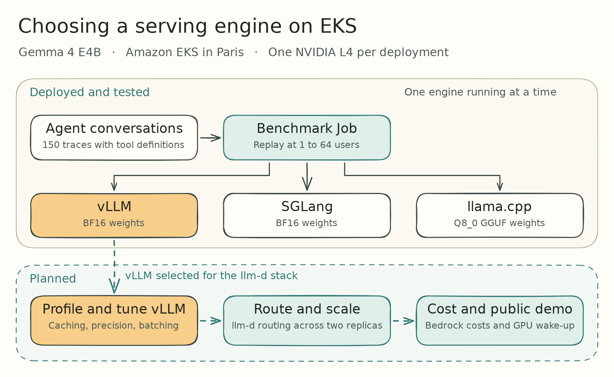
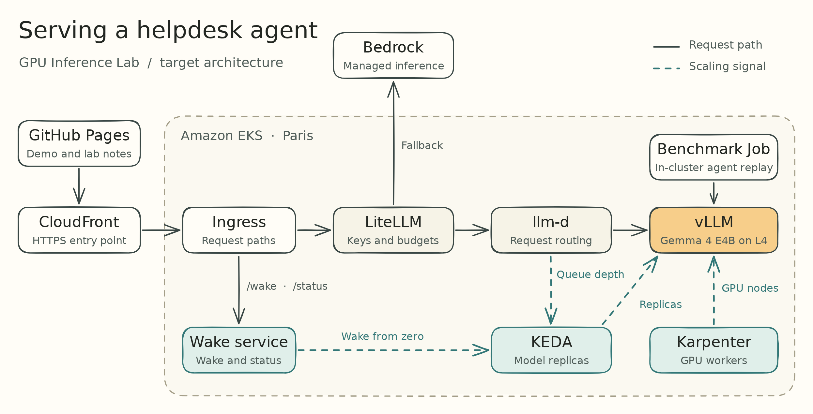

<h1 align="center"></h1>

We’re building a GPU inference service on **Amazon EKS in Paris**. We deployed **vLLM, SGLang and llama.cpp** in turn, served Gemma 4 E4B on one NVIDIA L4, and sent each engine the same multi-turn agent traffic. We chose **vLLM** for the rest of the project. The plan is to tune it on one GPU, route conversations across two replicas, and run a public demo that can wake an idle GPU on demand.

**The scenario.** Imagine a company self-hosting an internal helpdesk agent so it can control where employee requests are processed. When several employees ask for help at once, how quickly does the answer start streaming? Does the agent call the right tools? What does it cost to meet that target?

[Project goals](#project-goals) · [System architecture](#system-architecture) · [Lab notes](#lab-notes)

## Project goals

[Editable Excalidraw file](docs/assets/experiment-map.excalidraw)

1. **Deploy three engines and choose one for the service.** Each engine had its own Kubernetes Deployment and Service. We replayed the same conversations at loads from 1 to 64 users and measured when the first text or tool-call chunk arrived. The target was under one second for 90% of requests. SGLang sustained the highest tested load under target. We chose vLLM because it met the target at 16 users and is llm-d’s default model server. It can report which prompt prefixes each replica has cached, which matters when we test routing repeated helpdesk turns to a replica that can reuse them. [Engine comparison and decision](notes/08-engine-comparison.md) · [llm-d model servers](https://llm-d.ai/docs/architecture/model-servers)
2. **Optimize vLLM on one GPU.** We’ll profile the baseline to find where requests spend their time as load rises. Then we’ll change one setting at a time and check how caching, quantization, batching and speculative decoding affect latency, capacity and tool-call accuracy. [vLLM baseline](notes/05-vllm-baseline.md)
3. **Decide when to run the GPU.** The lab will measure the cost per million tokens at different utilization levels, compare self-hosting with Amazon Bedrock, and time how long a visitor waits when the service starts cold.

## System architecture

**Built so far.** Terraform provisions EKS, Karpenter supplies GPU workers, and a Kubernetes Job replays multi-turn agent traffic against a model server inside the cluster. Prometheus and Grafana provide monitoring. The workload, tool-call evaluator and deployment manifests are in the repository. [Infrastructure](infra/) · [Kubernetes manifests](k8s/) · [Workload](workload/) · [Evaluation](eval/)

**Planned public service.** Visitors will be able to browse the lab notes on GitHub Pages while the GPUs are idle. The diagram shows the intended request path once the demo is live.

[View the full-size diagram](docs/assets/architecture.png) · [Editable Excalidraw file](docs/assets/architecture.excalidraw)

When a visitor clicks **Wake the demo**, the site will show startup progress until chat is ready. KEDA controls the number of model replicas. Karpenter provisions a GPU node when a replica needs one and removes it when it is idle. Timing that sequence is part of the experiment.

## Lab notes

| Stage | What the lab investigates | Reading |
| :--- | :--- | :--- |
| Agent workload | Define the multi-turn traffic and how tool calls are scored. | [Agent workload](notes/01-agent-workload.md) |
| Single-GPU deployments | Serve Gemma on each engine and measure latency under load. | [vLLM baseline](notes/05-vllm-baseline.md) · [SGLang](notes/06-sglang.md) · [llama.cpp](notes/07-llamacpp.md) |
| Engine selection | Choose an engine for the helpdesk service and the routing experiments. | [Engine comparison](notes/08-engine-comparison.md) |
| vLLM optimization | Find the single-GPU bottleneck, then test prefix caching, FP8 weights and KV cache, batching, and speculative decoding. | Planned |
| Operating the service | Compare cache-aware routing with round-robin on two replicas. Measure scale-to-zero, cold starts and recovery after a Spot interruption. | Planned |
| Cost and public demo | Identify the utilization at which self-hosting pays off. Publish the evidence and let visitors try the deployment. | Planned |

[Browse all lab notes](notes/)
