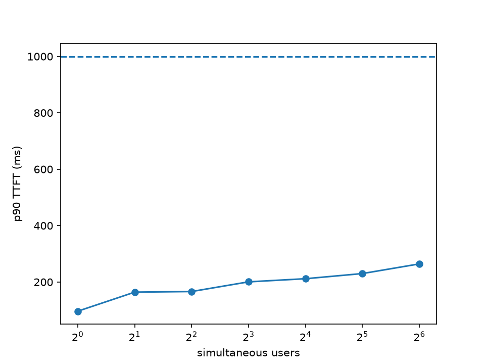

# Serving Gemma 4 E4B with SGLang on one L4

**`--mem-fraction-static=0.80`** gave the BF16 weights and KV cache enough GPU memory to serve the workload. We kept the per-request context limit at 16,384 tokens and let SGLang choose its request concurrency. [Deployment manifest](../k8s/sglang.yaml)

The server used the `gemma4` tool-call parser and the documented default of thinking off. The image tag was `latest`, so the exact build is unknown. [SGLang Gemma 4 guide](https://github.com/sgl-project/sglang/blob/main/docs/cookbook/autoregressive/Google/Gemma4.mdx#43-reasoning-thinking-mode)

At **64 users**, the highest load tested, p90 time to first output was **264 ms**. [Raw timings](../results/sglang/) · [Engine comparison](08-engine-comparison.md)

| Users | First output < 1 s / total | p50 TTFT (ms) | p90 TTFT (ms) | Est. chunk gap (ms) | Chunks/s | Errors |
| ---: | ---: | ---: | ---: | ---: | ---: | ---: |
| 1 | 44 / 44 | 82.65 | 96.30 | 41.02 | 11.30 | 0 |
| 2 | 88 / 88 | 110.78 | 163.99 | 41.98 | 22.99 | 0 |
| 4 | 201 / 201 | 138.22 | 166.16 | 43.69 | 38.83 | 0 |
| 8 | 367 / 367 | 147.88 | 200.49 | 46.82 | 76.29 | 0 |
| 16 | 738 / 739 | 153.87 | 211.58 | 53.41 | 126.05 | 0 |
| 32 | 1,239 / 1,251 | 171.01 | 229.90 | 70.18 | 230.29 | 0 |
| 64 | 1,906 / 2,018 | 188.31 | 264.19 | 97.21 | 374.52 | 0 |

TTFT is the time to the first text or tool-call chunk. Chunk gap estimates the interval between chunks from first output to stream completion, summarized as the median across requests with at least two chunks. [Metric definitions](../analysis/summarize.py)

