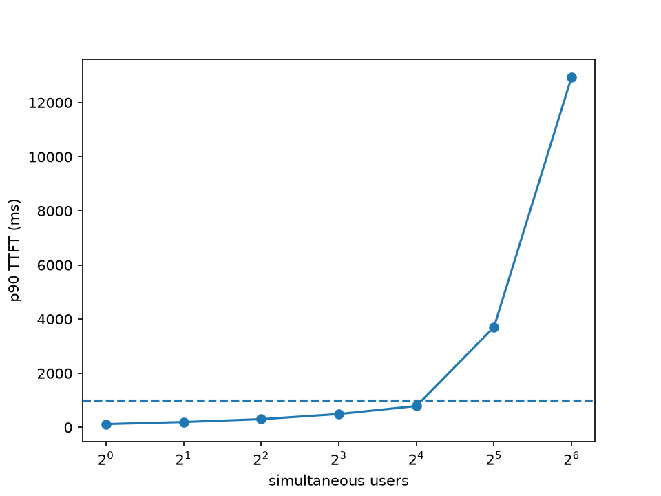

# Serving Gemma 4 E4B with llama.cpp on one L4

The CUDA server used Q8_0 GGUF weights and 16 parallel slots with 8,192 context tokens per slot. **`--reasoning off`** reserved the 300-token output budget for text and tool calls. [Deployment manifest](../k8s/llamacpp.yaml)

All 2,740 measured requests produced visible output. P90 time to first output rose from **788 ms at 16 users** to **3.71 s at 32**, crossing the one-second target. [Raw timings](../results/llamacpp/) · [Engine comparison](08-engine-comparison.md)

| Users | First output < 1 s / total | p50 TTFT (ms) | p90 TTFT (ms) | Est. chunk gap (ms) | Chunks/s | Errors |
| ---: | ---: | ---: | ---: | ---: | ---: | ---: |
| 1 | 58 / 58 | 110.32 | 120.96 | 24.31 | 13.81 | 0 |
| 2 | 113 / 113 | 125.96 | 196.76 | 25.38 | 27.81 | 0 |
| 4 | 208 / 208 | 183.77 | 302.60 | 33.15 | 45.09 | 0 |
| 8 | 288 / 296 | 340.90 | 492.20 | 69.58 | 63.79 | 0 |
| 16 | 419 / 440 | 571.20 | 788.37 | 126.82 | 75.97 | 0 |
| 32 | 81 / 774 | 2,729.40 | 3,705.54 | 96.83 | 134.85 | 0 |
| 64 | 45 / 851 | 11,732.82 | 12,947.98 | 97.50 | 139.75 | 0 |

TTFT is the time to the first text or tool-call chunk. Chunk gap estimates the interval between chunks from first output to stream completion, summarized as the median across requests with at least two chunks. [Metric definitions](../analysis/summarize.py)

