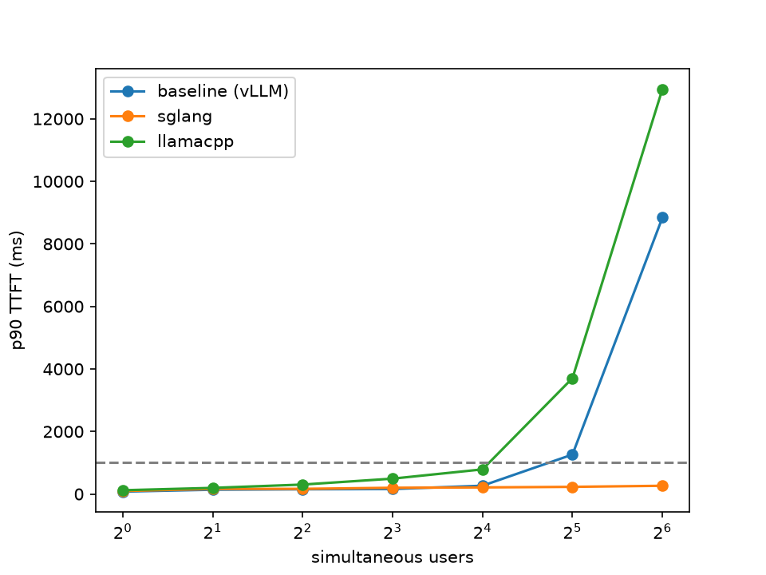

# Engine comparison: vLLM, SGLang and llama.cpp

**SGLang met the one-second p90 latency target through 64 concurrent users**, the highest load tested. vLLM and llama.cpp met it through 16. We chose vLLM for the next phase to build the two-replica routing experiment on llm-d’s default model server.

## Workload and deployments

Each engine served Gemma 4 E4B on one NVIDIA L4 (`g6.xlarge`, Amazon EKS in Paris). Simulated users drew from the same 150 scripted conversations, with tool definitions enabled and a 300-token output limit. Each user waited for a reply before sending another turn. The four-user warm-up allowed 60 seconds to start conversations. Each measured load allowed 180 seconds, with in-flight conversations finishing afterward. [Agent workload](01-agent-workload.md) · [Replay client](../workload/replay.py) · [Benchmark Job](../k8s/bench-job.tmpl.yaml)

| Engine | Weights | Context per request | Thinking |
| --- | --- | ---: | --- |
| vLLM `v0.33.0` | BF16 | 16,384 tokens | Off by default |
| SGLang `latest` | BF16 | 16,384 tokens | Documented default off, exact build unknown |
| llama.cpp `b12602-418fe97b5` | Q8_0 GGUF | 8,192 tokens per slot | Explicitly off |

## Results

Time to first token (TTFT) is measured at the client when the first text or tool-call chunk arrives. Capacity is the highest tested concurrency with p90 TTFT below one second.

| Engine | KV cache budget (tokens) | p90 TTFT, 1 user | p90 TTFT, 16 users | Streamed chunks/s, 16 users | Users at p90 < 1 s |
|---|---|---:|---:|---:|---:|
| [vLLM](05-vllm-baseline.md) | Unrecorded for this run | 77.07 ms | 266.50 ms | 142.56 | 16 |
| [SGLang](06-sglang.md) | Unrecorded for this run | 96.30 ms | 211.58 ms | 126.05 | 64 |
| [llama.cpp](07-llamacpp.md) | 131,072 configured across 16 slots | 120.96 ms | 788.37 ms | 75.97 | 16 |

Throughput counts streamed chunks. Engines can group tokens differently, so chunks/s cannot establish which engine generated the most tokens/s. The llama.cpp cache figure is its configured context budget. [Metric calculation](../analysis/summarize.py) · [llama.cpp manifest](../k8s/llamacpp.yaml)

## What each engine does differently

- **vLLM (PagedAttention).** A block table maps each sequence to KV-cache blocks that can occupy different locations in GPU memory. The engine allocates more blocks as the sequence grows. vLLM had the lowest p90 time to first output from one to eight users. [PagedAttention paper](https://arxiv.org/abs/2309.06180)
- **SGLang (RadixAttention).** A radix tree indexes cached prompt prefixes so requests can reuse the attention keys and values for matching tokens. Our workload repeats a long prefix. SGLang had the highest measured capacity, though the run did not measure cache hits. [RadixAttention design](https://www.lmsys.org/blog/2024-01-17-sglang/)
- **llama.cpp (parallel slots).** The server ran 16 request slots. Once all slots are occupied, arriving requests wait. P90 time to first output crossed one second between 16 and 32 users. [llama.cpp server documentation](https://github.com/ggml-org/llama.cpp/blob/418fe97b5/tools/server/README.md)

## Limits

Each deployment has one recorded sweep. Weight precision, context budgets and scheduling settings differ, so these measurements compare the three deployed configurations. Only vLLM ran the separate tool-call evaluation, matching all expected function names and arguments in 130 of 200 cases (65%). [Quality score](../results/baseline%20%28vLLM%29/quality.txt)

## Decision

Use the **16-user vLLM baseline** to measure what tuning buys on one L4. For the two-replica experiment, llm-d can consume vLLM’s KV-cache events to route a returning conversation to a replica that already holds its prefix. vLLM is llm-d’s default model server and has documented deployment paths in KServe and on EKS. [llm-d model servers](https://llm-d.ai/docs/architecture/model-servers) · [KServe runtime](https://kserve.github.io/website/docs/model-serving/generative-inference/overview) · [AWS EKS inference guide](https://docs.aws.amazon.com/eks/latest/userguide/ml-inference-load-serve-model.html)
