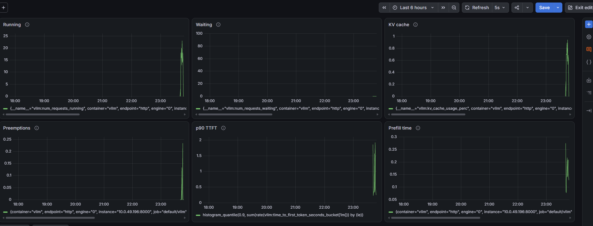
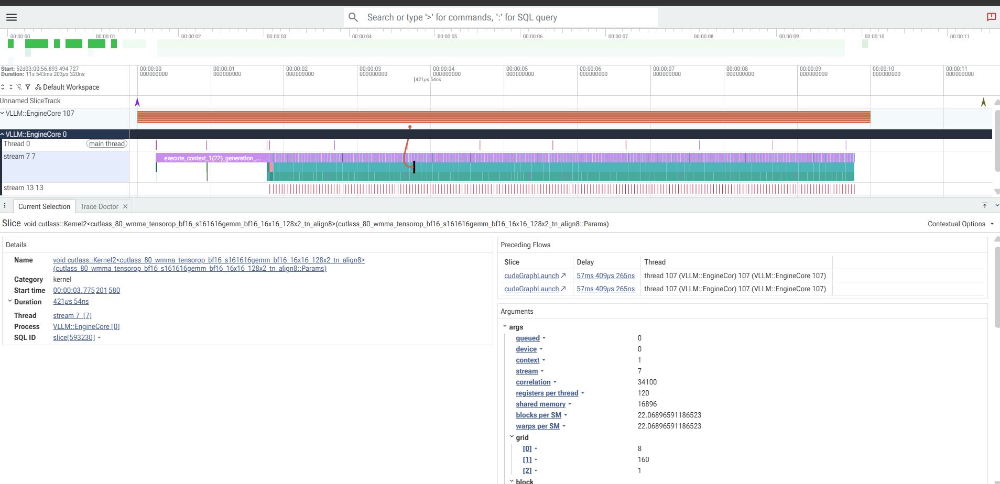
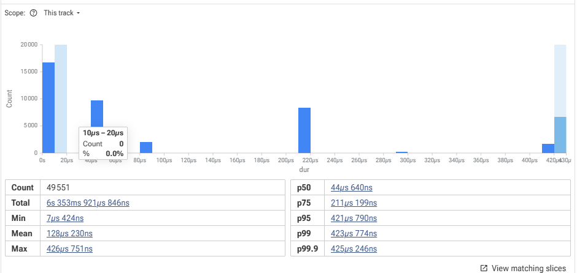

# Diagnosing vLLM on one NVIDIA L4

## Why

The vLLM baseline missed the one-second p90 time-to-first-output target at 32 concurrent users. Was the GPU running short of space for active conversations? [Baseline](05-vllm-baseline.md)

## What I expected

If the KV cache was under pressure, high cache occupancy and preemptions should appear together during the 32-user replay.

## What I measured

### KV-cache pressure at 32 users

With a five-minute window for starting conversations, 1,980 of 2,106 requests (94.0%) received text or a tool call within one second. P90 was **706 ms**, compared with **1,263 ms** in the baseline. [Diagnostic timings](../results/diag/users_32.jsonl)

Prometheus counted **16 preemptions**. The vLLM logs showed KV-cache usage reaching **99.3%** and briefly recorded up to **9 waiting requests**. The dashboard sampled the queue every 30 seconds and missed those spikes.

### GPU time during decode

A separate trace captured 178 decode steps in which vLLM generated one token for each of eight requests. Across those steps, a single CUTLASS BF16 matrix multiplication kernel accounted for **5.68 s of the 6.07 s of kernel time on GPU stream 7 (93.7%)**. The unified attention kernel took 0.10 s (1.7%).

Across the full trace, the same kernel ran **49,551 times** and accumulated **6.354 s**, or **79.36%** of the profiler's total self CUDA time. Its median execution time was **44.64 µs** and its p95 was **421.79 µs**.

## What I learned

KV-cache capacity constrained the engine intermittently. A preempted request can need its prompt processed again, adding latency. This run still met the p90 target. The two runs give different outcomes at 32 users.

## Decision

Test prefix caching at 32 users with the same workload and duration. The diagnostic already recorded cache hits. Since the instructions and tool definitions repeat on every turn, I predict that **disabling prefix caching will increase p90 time to first output**. Compare cache-hit rate and p90 with caching on and off. [Agent workload](01-agent-workload.md)
